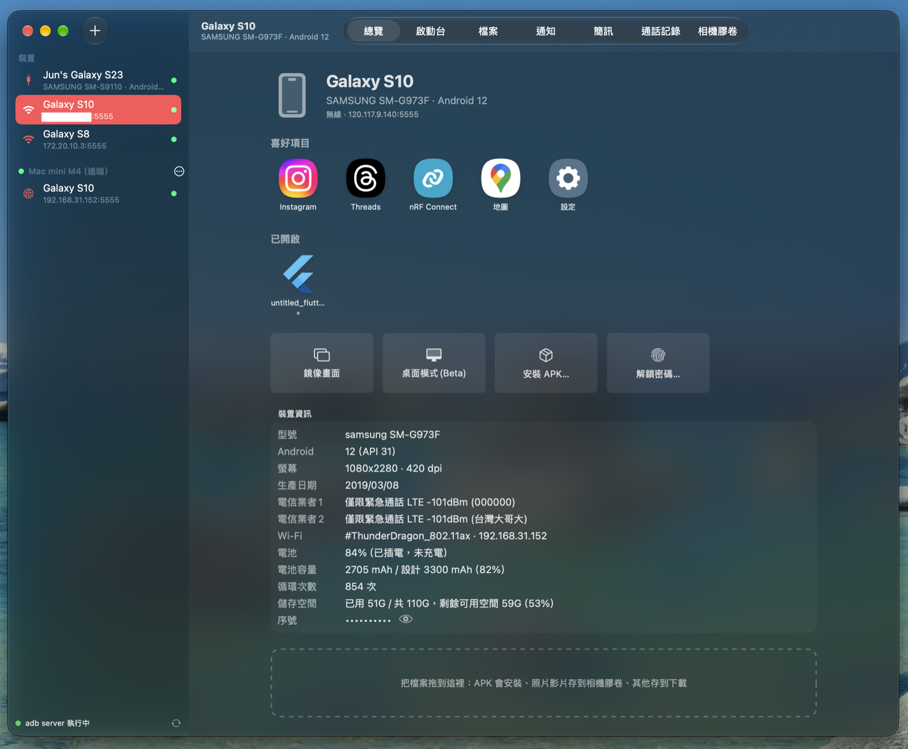
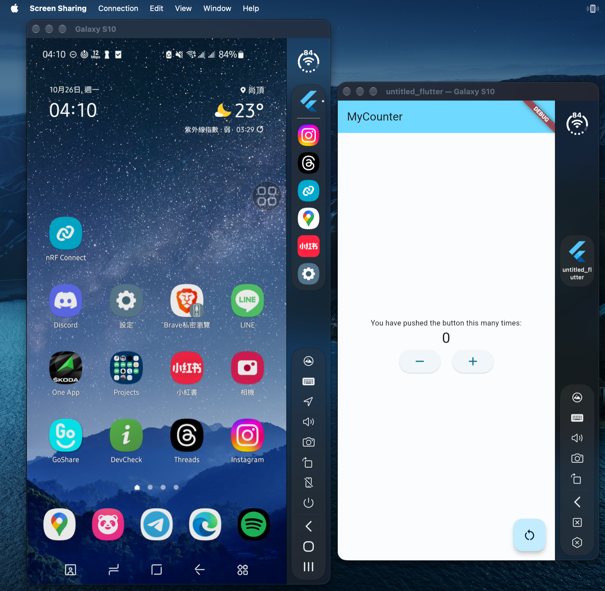
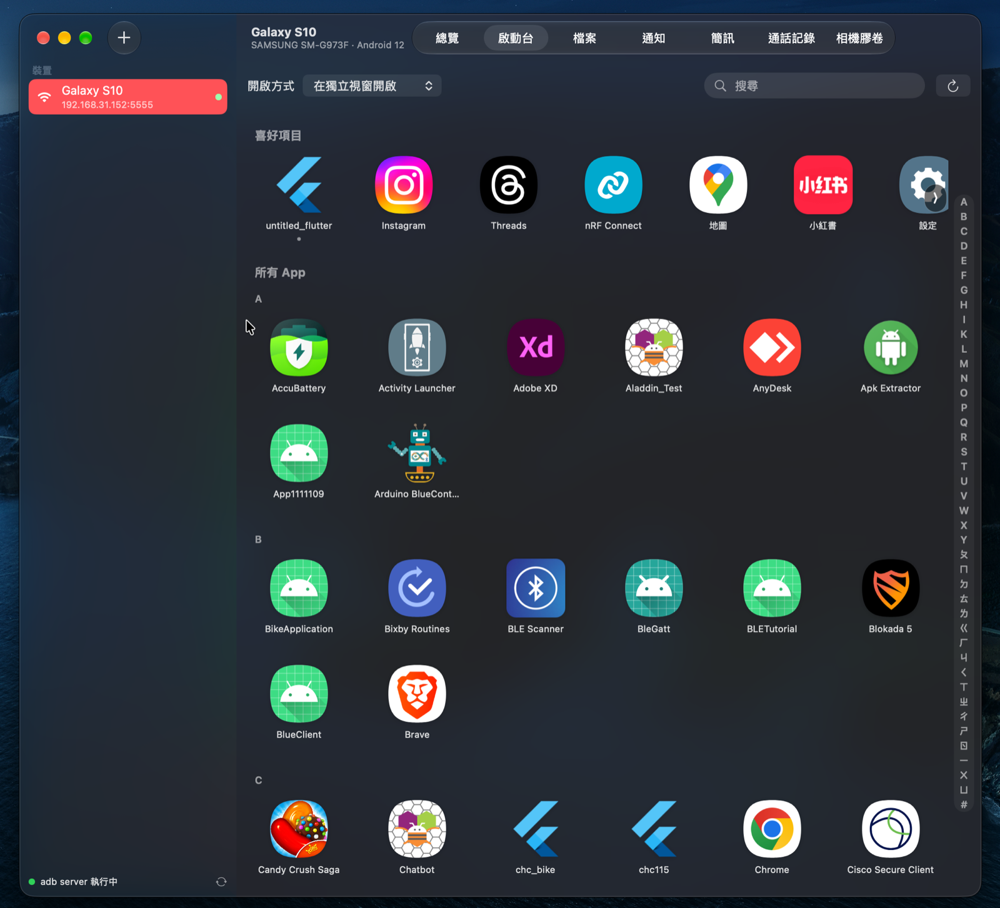
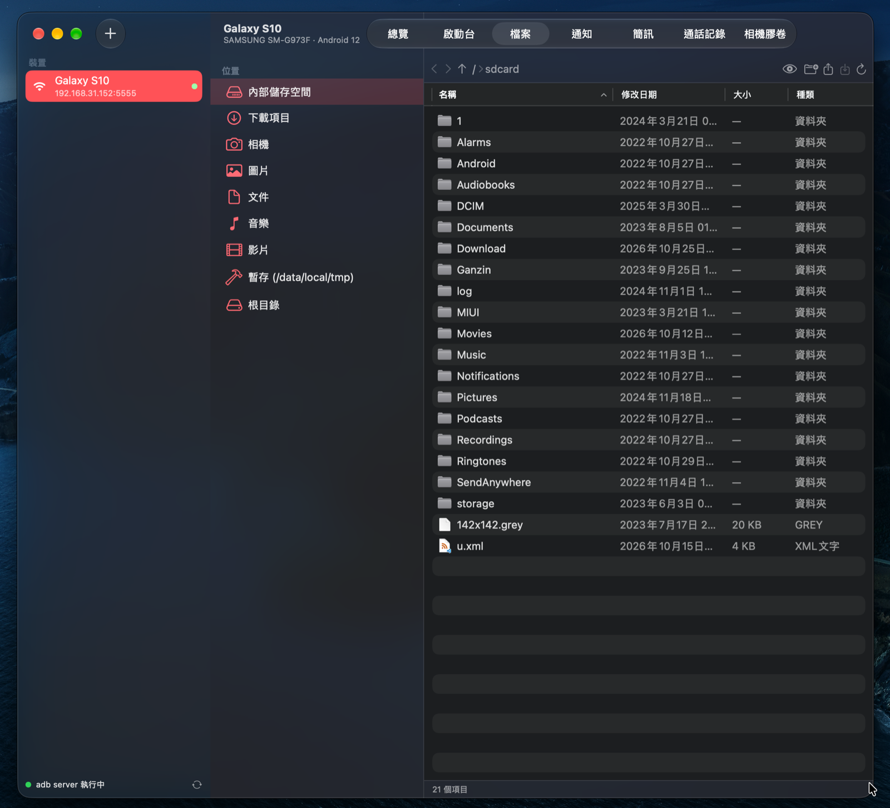
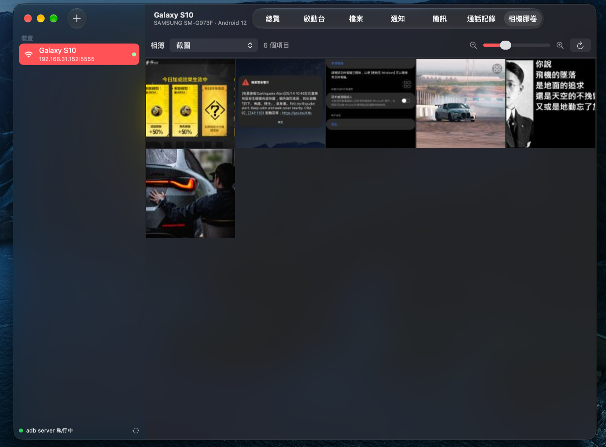
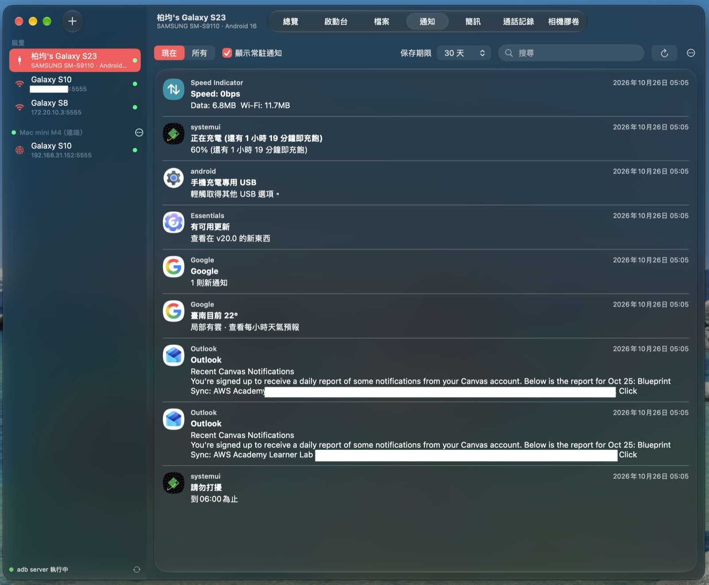
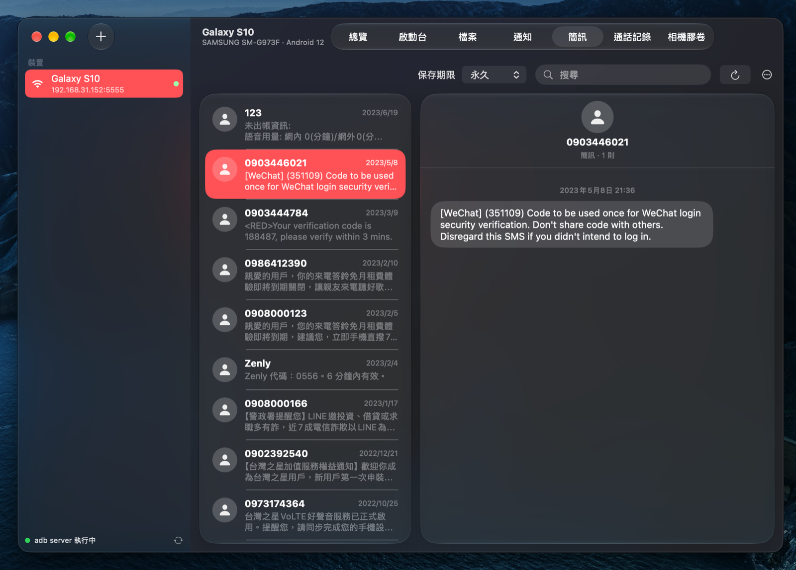
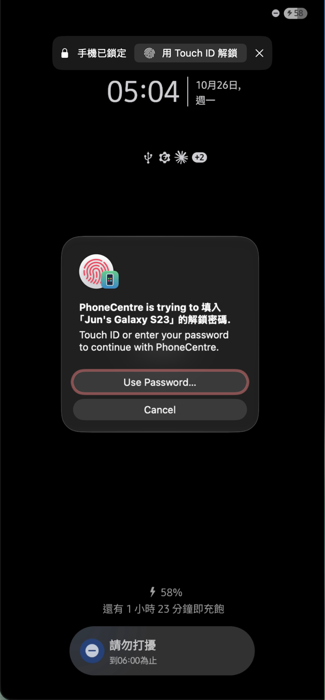
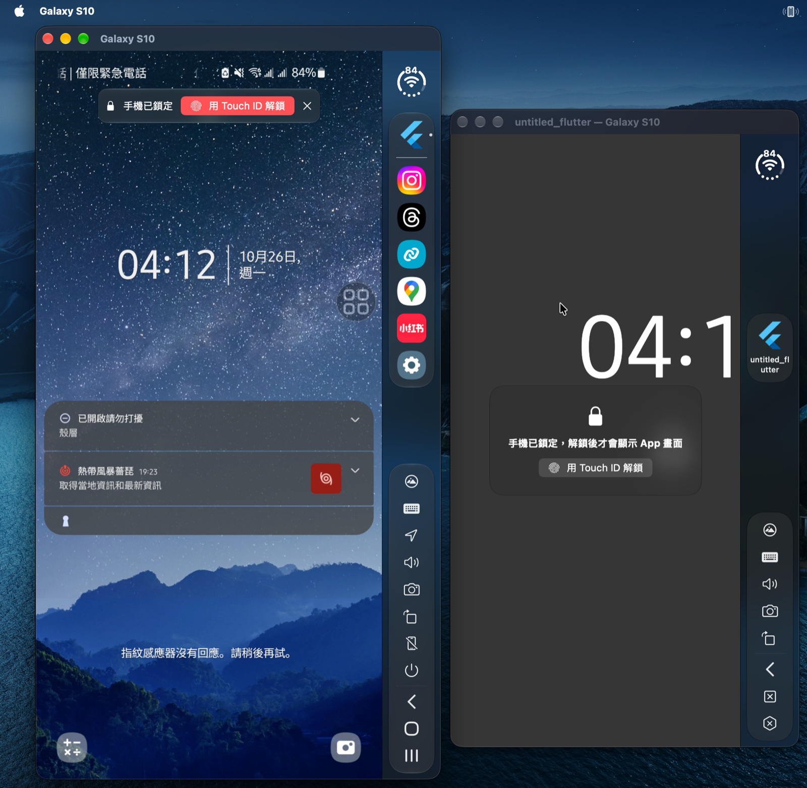

# PhoneCentre

在 Mac 上管理 Android 手機的原生 App（SwiftUI + AppKit）。
透過 adb 連接手機，用 scrcpy-server 鏡像畫面與遠端操作；另外提供 App 啟動台、檔案管理、相機膠卷、
通知／簡訊／通話記錄，以及讓手機上的 App 以 Mac 獨立視窗執行。

**Windows PC用戶可以使用[PhoneCentreonPC](../PhoneCentreOnPC) (Beta)**

> 這是作者自用的專案，**不保證任何功能在你的手機上可用**，使用前請先閱讀最下方的[免責聲明](#免責聲明)。



## 特色

### 總覽
- 側邊欄列出所有 USB、無線與遠端連線的手機，每台都有電池／網路／訊號狀態圖
- 側邊欄可以「中斷連線（保留在清單）」，之後一鍵連回去；也能從清單移除，或設定斷線時要不要自動重新連線
- 裝置資訊：型號、Android 版本、生產日期、電信業者（雙卡分開列出）、Wi-Fi、電池健康度與循環次數、儲存空間
- 喜好項目與已開啟的 App 一眼看到，點一下就開啟
- 一鍵鏡像畫面、桌面模式 (Beta)、安裝 APK、重新啟動手機；把檔案拖進來就安裝或存到手機

### 鏡像畫面與獨立 App 視窗

- 低延遲的手機畫面鏡像，滑鼠、觸控板（捲動、雙指縮放）、鍵盤都能操作；支援 Mac 輸入法打中文
- 手機的聲音可以傳到 Mac 播放，剪貼簿雙向同步
- 手機上的 App 可以在**虛擬顯示器**上執行，Mac 端變成一個獨立視窗（可在 Dock 上獨立顯示），類似「連結至 Windows」
- 右側欄有狀態環（電量、Wi-Fi／4G／5G、訊號格）、App 列、導覽列（畫質、輸入法、聲音、截圖、旋轉、黑屏、電源）
- 模擬定位：在地圖上點一下，手機就使用那個位置



### 啟動台

- 喜好項目、已開啟、所有 App（依英文字母與注音分組，右側索引快速捲動）
- 可以選擇在獨立視窗或手機主螢幕開啟；右鍵可強制停止、解除安裝、查看 App 資訊




### 檔案

- Finder 風格的手機檔案管理：排序、快速查看、重新命名、刪除、新增資料夾
- 拖進來上傳、拖到 Finder 下載
- 
  

### 相機膠卷

- Apple「照片」風格的格狀檢視；「所有照片」一次看完 DCIM 底下所有資料夾
- 可以只看照片或只看影片
- ⌘ 點選多選、⇧ 點選範圍選取、⌘A 全選，一次匯出到 Mac
- 縮圖在手機端產生，只傳小圖，捲動很順




### 通知、簡訊、通話記錄

- 只透過 adb 讀取，**不在手機上安裝任何 App**
- 資料只保存在這台 Mac（`~/Library/Application Support/PhoneCentre/Data`），可分別設定保存天數或隨時刪除
- 通知會記錄已清除的項目，點一下就在獨立視窗打開對應的 App





### 用 Mac 的 Touch ID 解鎖手機

- 偵測到手機在鎖定畫面時，用 Mac 的 Touch ID 或電腦密碼驗證後自動填入手機密碼；密碼存在 Mac 的鑰匙圈
- 自動填入期間手機會黑屏，旁邊的人看不到你的密碼或圖形
- 圖形解鎖是 **Beta**：部分機型（例如沒有螢幕下指紋、圖形位置比較下面的 Galaxy S8 等舊機）可能無法解鎖




### 遠端 PhoneCentre (Beta)
- 連到另一台 Mac 上的 PhoneCentre，直接使用它連接的手機（鏡像、檔案、App 等功能都能用）
- 點對點連線，以 TLS（PSK，金鑰由雙方共同的密碼經 PBKDF2 推導）加密，不經過任何第三方伺服器
- 這是 **Beta 功能**，可以在「設定 → 遠端 (Beta)」**完全關閉**：關閉後不連任何遠端主機、不開任何對外的 port，也不在區域網路上公告

## 系統需求與建置

- macOS 15 以上（macOS 26 會套用 Liquid Glass 外觀）、Apple 晶片
- 手機需開啟「開發人員選項 → USB 偵錯」（無線連線需要「無線偵錯」或先用 USB 轉成無線）
- 找不到 adb 時，App 會在你同意後從 Google 官方網站下載 Android SDK Platform-Tools

```sh
scripts/build.sh            # 輸出 build/PhoneCentre.app
scripts/build.sh --install  # 另外安裝到 /Applications
```

建置腳本會下載並驗證官方的 `scrcpy-server`（v3.3.4）。架構說明請看 [Readme_Architecture.md](Readme_Architecture.md)。

## 支援程度

**每個 Android 版本、每家廠商能用的功能都不一樣**，以下只是作者手邊機型的經驗，不代表任何保證：

- 音訊轉送需要 Android 11 以上；「Mac 與手機同時發聲」需要 Android 13 以上
- 獨立 App 視窗與桌面模式依賴 Android 的虛擬顯示器，舊版本或部分廠商的系統可能無法使用或顯示異常
- 電信業者、電池容量、循環次數、生產日期等資訊來自各廠商不同的系統欄位，有些手機讀不到
- 鈴聲模式、請勿打擾、方向鎖定等設定在不同廠牌、版本上的行為不同
- 圖形解鎖、桌面模式、遠端 PhoneCentre 為 Beta 功能

## 第三方元件與授權條款

PhoneCentre 使用以下第三方軟體。**使用本專案時，你也必須遵守這些元件各自的授權條款。**

| 元件 | 用途 | 授權 |
| --- | --- | --- |
| [scrcpy](https://github.com/Genymobile/scrcpy) 的 `scrcpy-server`（v3.3.4，官方 release 檔、未修改） | 在手機端擷取畫面、聲音並注入操作 | [Apache License 2.0](ThirdParty/licenses/scrcpy-LICENSE.txt)，Copyright (C) 2018 Genymobile、(C) 2018-2025 Romain Vimont |
| [Android SDK Platform-Tools](https://developer.android.com/tools/releases/platform-tools)（adb） | 與手機溝通 | [Android Software Development Kit License Agreement](https://developer.android.com/studio/terms) |

- `scrcpy-server` 隨 App 一起散布，授權全文與聲明放在 [ThirdParty/NOTICE.md](ThirdParty/NOTICE.md) 與 `ThirdParty/licenses/`，也會一起複製進 `.app`。
- Mac 端的鏡像用戶端（解碼、顯示、操控協定）由本專案以 Swift 獨立實作，沒有使用 scrcpy 用戶端的程式碼。
- **adb 不隨本專案散布**。App 只會在你同意後從 Google 官方網址下載，下載與使用 adb 即表示你同意 Android SDK 授權條款。
- 「scrcpy」與「Android」分別是其權利人的名稱與商標，本專案與 Genymobile、Google 沒有任何關聯，也未受其背書。

## 隱私

- 手機上的所有資料（畫面、檔案、照片、通知、簡訊、通話記錄、裝置資訊）都只在你的 Mac 與手機之間傳輸與保存。
- 本專案**不會收集或回傳任何個人資料**，沒有分析、追蹤或遙測，也沒有自己的伺服器。
- 唯一會跨電腦連線的是「遠端 PhoneCentre (Beta)」：它是兩台 PhoneCentre 之間的點對點加密連線，不經過任何中繼伺服器，理論上作者與任何第三人都無法取得連線內容。
  很在意的話，可以在「設定 → 遠端 (Beta)」完全關閉這個功能。
- 手機解鎖密碼存在 Mac 的鑰匙圈；只有在你主動開啟「密碼也存到這個資料夾」時，才會以明碼寫進你自己指定的設定資料夾。

## 免責聲明

- 本專案是作者**個人自用**而開發的工具，以「現狀」提供，不提供任何明示或默示的保證，包括但不限於可用性、正確性、適售性或特定用途適用性。
- 每個 Android 版本、每家廠商的手機能使用的功能都不一樣，**不保證任何功能在你的手機上可用或正常運作**。
- 本專案會透過 adb 以「USB 偵錯」權限操作你的手機，包括安裝或解除安裝 App、刪除檔案、強制停止 App、重新啟動手機、輸入解鎖密碼等。
  請自行評估風險，並在使用前備份重要資料。
- **使用者使用本專案所發生的任何問題（包括但不限於資料遺失、裝置損壞、帳號或資安問題、違反第三方條款等），皆由使用者自行負責**，作者不負任何責任。
- 使用本專案時，請一併遵守上方列出的第三方元件授權條款，以及你所在地區的相關法律。
